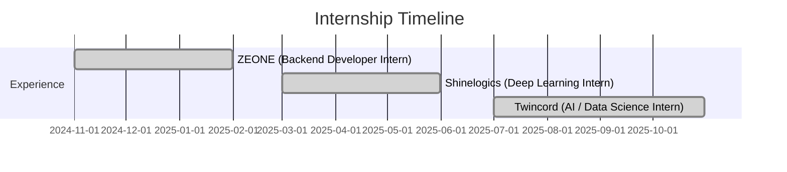

<h1 align="center">Hi 👋, I'm Vijayakanth M</h1>
<h3 align="center">🚀 AI &amp; ML Engineer | 🤖 Agentic AI &amp; RAG Builder | 💻 Full Stack Developer</h3>

  

---

### 🧠 About Me

- 🎓 Final-year B.Tech **AI & ML** student at **Kongu Engineering College**, Erode (`CGPA: 8.49`, May 2027)
- 🤖 Skilled in **Python, Machine Learning, Deep Learning, Computer Vision, NLP, LLMs, RAG, and Agentic AI**
- 🏆 **Winner — CTD 2026 AI/ML Hackathon** at **IIT Bombay** · **Top-4 Finalist — CTD 2025** @ IIT Bombay · **SIH 2025 National Finalist**
- 🧪 Completed **3 internships** across AI/Data Science, Deep Learning, and Backend Engineering
- 📫 Contact: [vikymahendiran123@gmail.com](https://mail.google.com/mail/?view=cm&fs=1&to=vikymahendiran123@gmail.com)
- 🌐 Portfolio: [vkportfolio-8a5cb.web.app](https://vkportfolio-8a5cb.web.app)

---

### 🌐 Connect With Me

  
  
  

---

### 💼 Skills & Tools

**Languages**  

**AI / ML & Data**  

**Frameworks, Databases & Platforms**  

---

### 📊 GitHub Stats

  
  
  

---

### 🧠 LeetCode Stats

  

---

### 🚀 Notable Projects

| Project | Tech Stack | Highlights |
|--------|-------------|-------------|
| **Autonomous MEP AI Takeoff & Copilot Studio** | Python, PyTorch, FastAPI, LangGraph, FastMCP, PyMuPDF, SQLite | Blueprint analysis, equipment counting, pipe/duct measurement & AI copilot achieving **84.11% takeoff accuracy** and **91.8% spatial F1** |
| [**ResumeForge — MCP NLP Pipeline**](https://github.com/vijayakanth06/ResumeForge) | Python, FastMCP, MCP Agents, NLP, RAG, LLM | 5-tool FastMCP server aggregating LinkedIn, GitHub & LeetCode with **87% ATS accuracy**, cutting tailoring from 2h to **<10s** (4.2s avg) |
| [**Fabric Defect Detection System**](https://github.com/vijayakanth06/Fabric_defect_detect) | Python, TensorFlow, CNN, OpenCV, Flask, IoT | Real-time ResNet/EfficientNet pipeline with **96.8% accuracy** on 2,000+ samples and **<200ms latency** (**SIH 2025 Finals**) |
| [**ProTube — Educational Video Platform**](https://github.com/vijayakanth06/protube) | React, Node.js/Express, Supabase, Redis, TailwindCSS, JWT | Distraction-free streaming with **99.2% short-form blocking accuracy**, AI search & Chrome curator (**94% retention** across 40+ users) |
| [**Material & Quantity Detection**](https://github.com/vijayakanth06/ctd) | Python, Regression, Feature Engineering, ML Pipeline | Construction material & quantity prediction with **85% accuracy** (**IIT Bombay CTD 2025 Top-4 Finalist**) |
| [**ClauseWise — AI Legal Analyzer**](https://github.com/vijayakanth06/genai_hackathon_ibm) | LLM, IBM Granite, NLP, Ollama | AI legal assistant that simplifies clauses and extracts key entities |

---

### 🧪 Internship Timeline

---

### 🏅 Awards & Achievements

- 🏆 **Winner** — CTD 2026 AI/ML Hackathon, CTAI Foundation @ **IIT Bombay** (Oct 2026)
- 🏅 **Finalist** — AI Summit 2026 Buildathon, HCL & GUVI (Feb 2026)
- 🇮🇳 **National Finalist** — Smart India Hackathon (SIH 2025) (Dec 2025)
- 🏆 **Top 4 Finalist** — CTD 2025 International AI/ML Hackathon @ **IIT Bombay** (Oct 2025)
- 🥇 **1st Place** — SIH Internal Hackathon 2025, KEC (Sep 2025)
- 🥉 **3rd Place** — CognitiveX GenAI 24hr Hackathon, IBM Skill Build (Sep 2025)
- 🥈 **2nd Place** — Ideathon'25 Project Presentation, KEC (Jul 2025)
- 🏆 **Best Presentation** — BYTS India Hackathon (BIH) 1.0, KEC (Apr 2025)
- 🥇 **1st Place** — Hacksphere 2025 (24hr Hackathon) & PRODOTHON / ENVISTAS 2025

---

### 📜 Certifications

- 📌 **Create Your First Gemini Enterprise Application** — Google (May 2026)
- 📌 **Fundamentals of MCP** — Hugging Face (Jan 2026)
- 📌 **Generative AI with Diffusion Models** — NVIDIA (Sep 2025)
- 📌 **MongoDB Node.js Associate Developer** — MongoDB University (Dec 2024)

---

### ⚡ Fun Facts

- 🧠 Building production **RAG, FastMCP & Agentic AI** pipelines from scratch
- ⚡ Deploying low-latency **Deep Learning & Computer Vision** models on edge & cloud
- 🔥 Thriving in 24-hour hackathons — always ready to ship under pressure!

---
